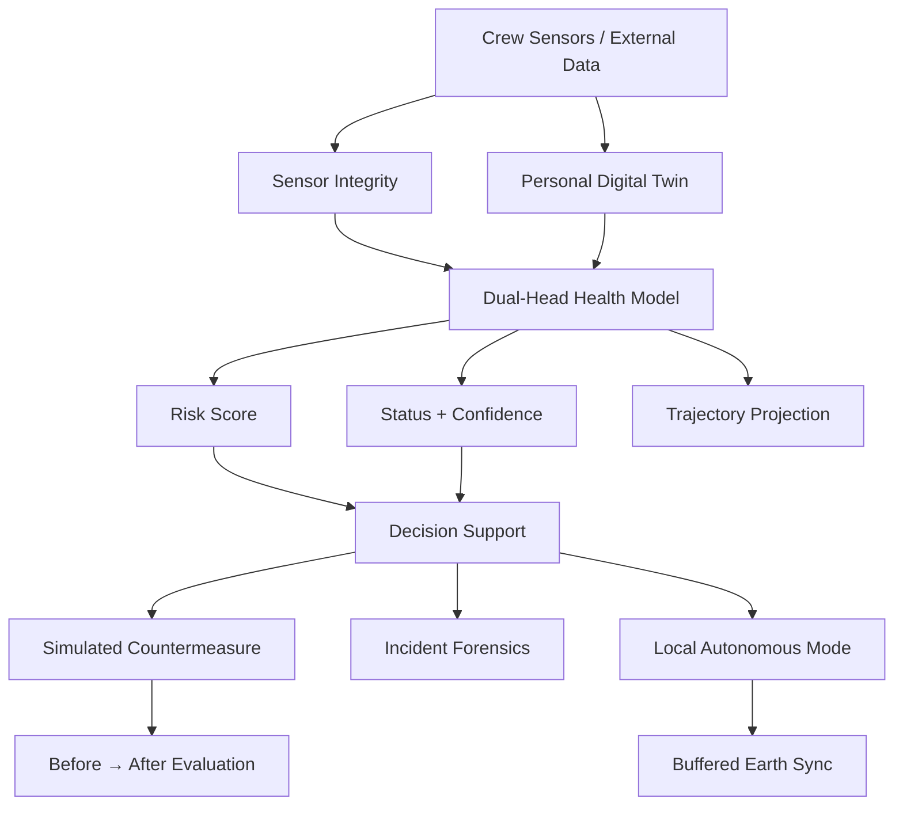

# AstroHealth Mission Control

**When astronauts cannot wait for Earth, AstroHealth detects deterioration, predicts what comes next, and supports action locally.**

AstroHealth is a student engineering demonstration for NASA Space Apps Challenge 2026. It combines synthetic astronaut telemetry, a dual-head neural network, personal baselines, trajectory projection, sensor-integrity analysis, simulated closed-loop countermeasures, communications-loss autonomy, external-data validation, and robustness testing.

## Important scientific boundary

AstroHealth is **not a medical device, clinical predictor, or flight-certified system**. The default training data are synthetic. External research data are explicitly labelled as external and must be used under their own access and licensing rules.

The 25/55 risk-status bands are model-status thresholds used by this project. They are **not NASA medical limits**.

## Run locally

```bash
pip install -r requirements.txt
streamlit run frontend.py
```

Required project files:

- `frontend.py`
- `backend.py`
- `nominal_telemetry.csv`
- `warning_telemetry.csv`
- `critical_telemetry.csv`

## Validation and evidence

The diagnostics tab contains:

- held-out synthetic test metrics
- confusion matrix
- limitations statement
- standards/data provenance
- external/research dataset validation
- descriptive real-data vital-sign sanity check
- robustness/generalization suite

## NASA / research context

The application links to the current NASA-STD-3001 Volume 2 pages for atmospheric and spacesuit monitoring context. NASA-STD-3001 discusses trend analysis of environmental and suit data and monitoring of pressure, ppO2 and ppCO2 for suited operations.

Useful sources:

- NASA-STD-3001 Volume 2: https://www.nasa.gov/reference/nasa-std-3001v2/
- NASA Volume 2, Natural and Induced Environments: https://www.nasa.gov/reference/6-0-natural-and-induced-environments-vol-2/
- NASA Volume 2, Spacesuits: https://www.nasa.gov/reference/11-0-spacesuits-vol-2/
- NASA Open Science Data Repository: https://osdr.nasa.gov/
- PhysioNet: https://physionet.org/

## Architecture


